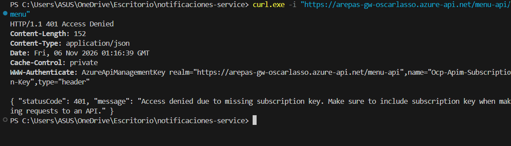
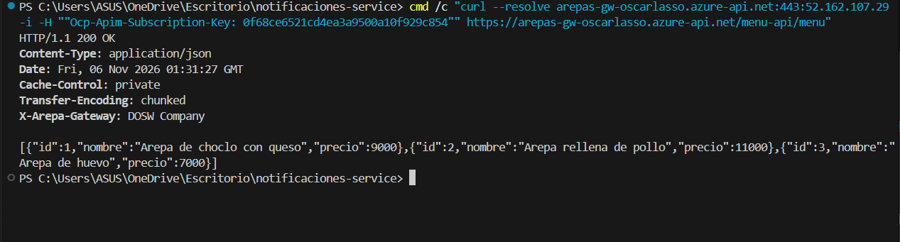
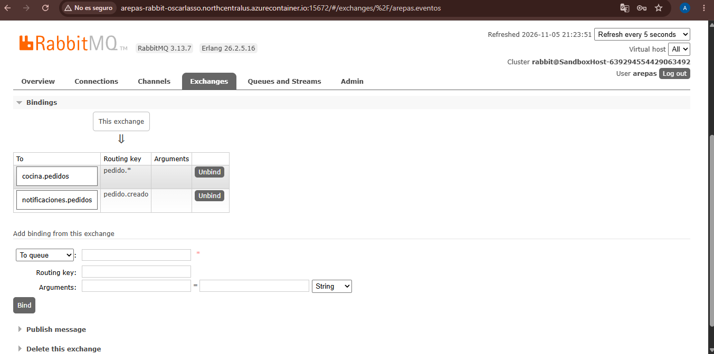
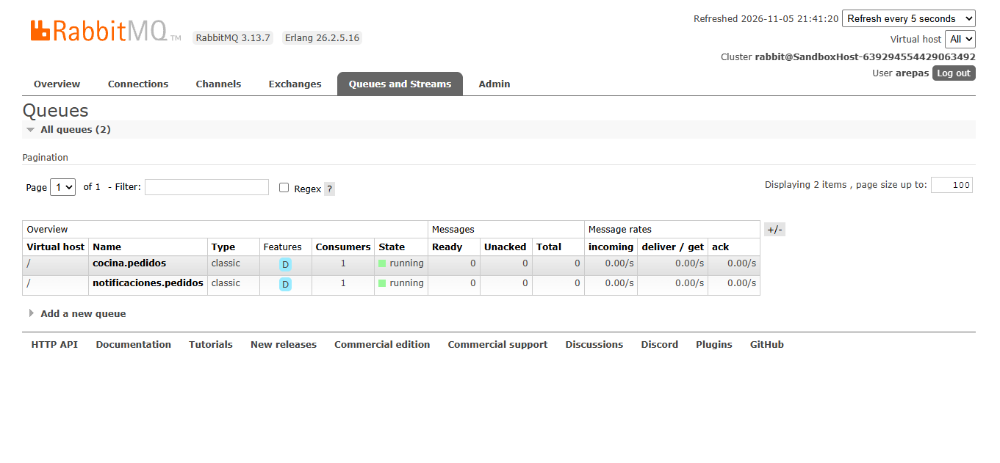
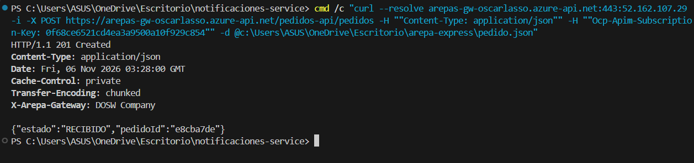
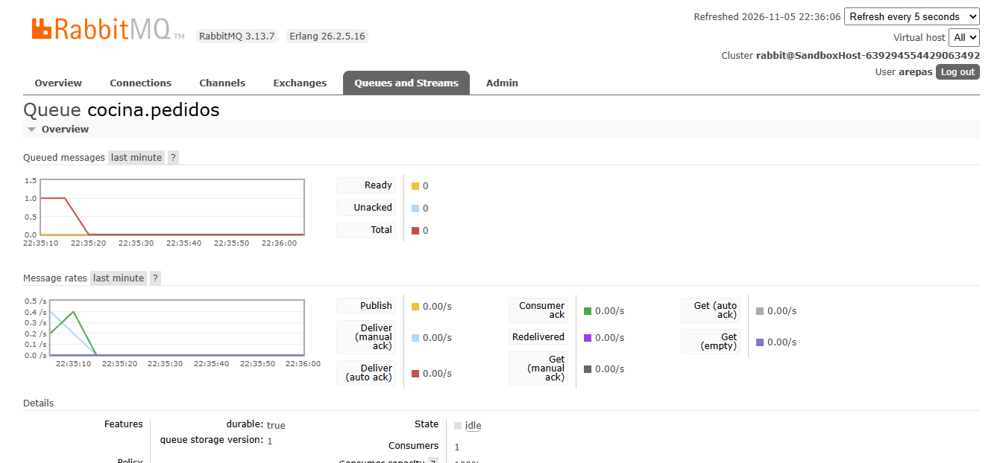

# Arepa Express · Documentación y Evidencias

Repositorio central de documentación técnica y evidencias del laboratorio **Arepa Express: API Gateway y RabbitMQ en Azure** (DOSW, Semana 14).

El sistema implementa una arquitectura distribuida basada en microservicios en Spring Boot 3.5.x con Java 21, desplegados sobre **Azure Container Apps**, orquestados por un **API Gateway (Azure API Management)** y comunicados asíncronamente mediante **RabbitMQ** en Azure Container Instances.

---

## Repositorios del Sistema

- [menu-service](https://github.com/arepa-express-dosw/menu-service): Catálogo de productos y precios (`GET /menu`).
- [pedidos-service](https://github.com/arepa-express-dosw/pedidos-service): Recepción de pedidos y publicación de eventos (`POST /pedidos`).
- [cocina-service](https://github.com/arepa-express-dosw/cocina-service): Procesamiento asíncrono de órdenes (`cocina.pedidos`).
- [notificaciones-service](https://github.com/arepa-express-dosw/notificaciones-service): Envío de notificaciones al cliente (`notificaciones.pedidos`).
- [docs](https://github.com/arepa-express-dosw/docs): Documentación general, informe técnico y capturas de verificación.

---

## Evidencias de Despliegue y Verificación

### 1. Acceso perimetral sin suscripción (HTTP 401)
Demuestra el control de acceso en el API Gateway. Al invocar el endpoint sin la cabecera `Ocp-Apim-Subscription-Key`, la petición es rechazada en el perímetro sin consumir recursos del backend.

---

### 2. Acceso autorizado y política de salida (HTTP 200)
Al incluir una llave de suscripción válida, el gateway enruta la llamada al microservicio `menu-service`. La respuesta aplica la directiva de salida inyectando el encabezado `X-Arepa-Gateway: DOSW Company` junto con el catálogo de arepas.

---

### 3. Topología de RabbitMQ: Topic Exchange y Bindings
Muestra la configuración del intercambio `arepas.eventos` (tipo `topic`) y sus bindings hacia las colas de los servicios consumidores:
- `cocina.pedidos` con la routing key `pedido.*`
- `notificaciones.pedidos` con la routing key `pedido.creado`

---

### 4. Consumidores activos en colas
Evidencia que los microservicios `cocina-service` y `notificaciones-service` en Azure Container Apps mantienen conexiones AMQP persistentes, registrando un consumidor activo (`Consumers: 1`) en cada cola.

---

### 5. Creación de pedidos a través del Gateway (HTTP 201)
Comprueba el flujo de negocio al invocar `POST /pedidos-api/pedidos` a través del gateway. El servicio registra la orden, responde con `201 Created` y el identificador generado (`pedidoId`), y publica el evento `pedido.creado` en el broker.

---

### 6. Entrega y procesamiento en los consumidores (Ack)
Verifica el procesamiento asíncrono en el broker. Al ingresar pedidos a la cola `cocina.pedidos`, el contenedor consume el evento de inmediato y emite la confirmación (`Consumer ack`), manteniendo en cero los mensajes acumulados.

---

## Contenido adicional

Para conocer el paso a paso del aprovisionamiento en Azure, el análisis de los 3 experimentos arquitectónicos (patrón Pub/Sub, Work Queues y persistencia en colas) y las respuestas a las preguntas de reflexión, consulta el documento:

- [Informe Técnico de Laboratorio](informe-laboratorio.md)
