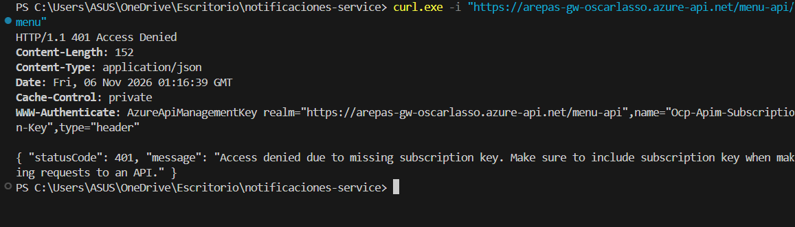
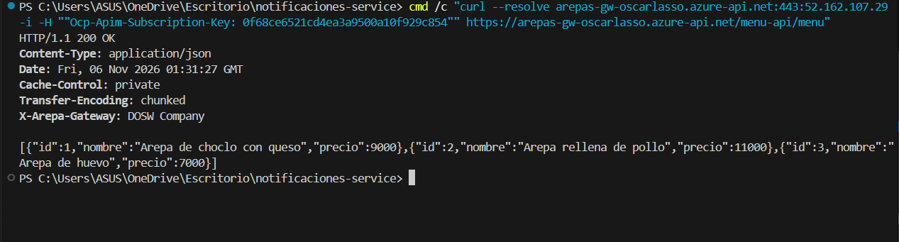
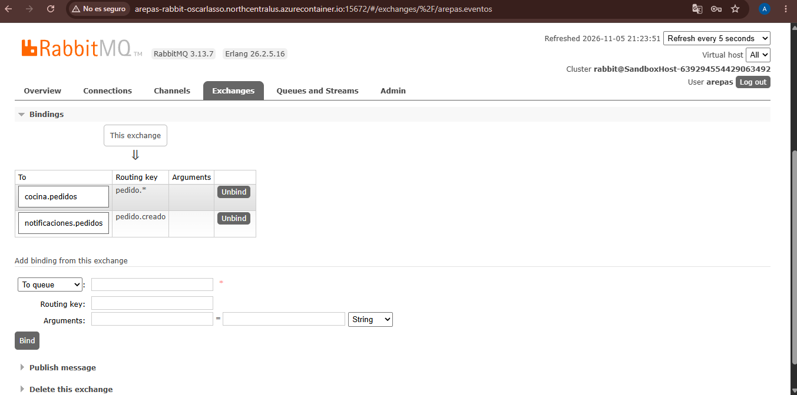
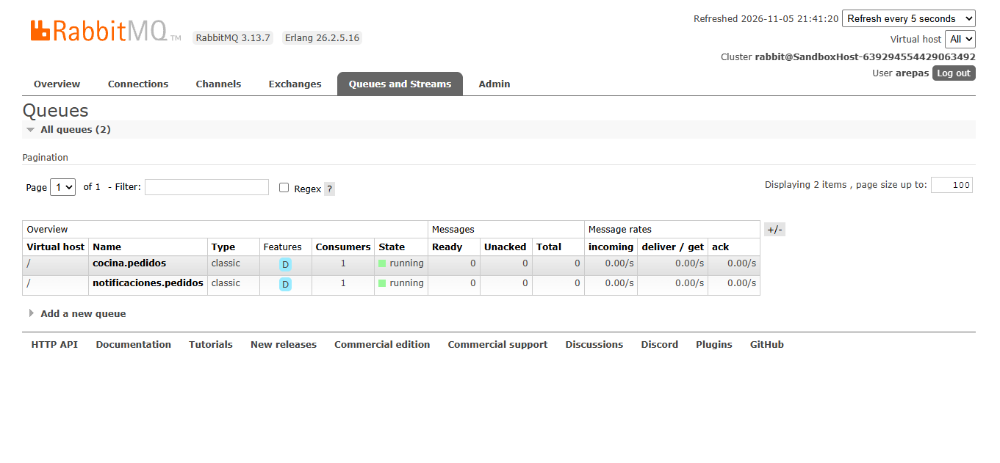
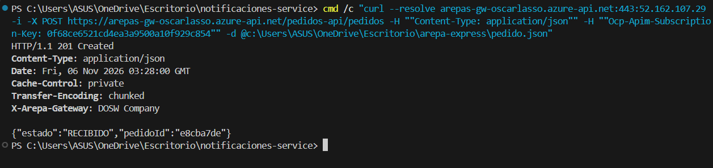
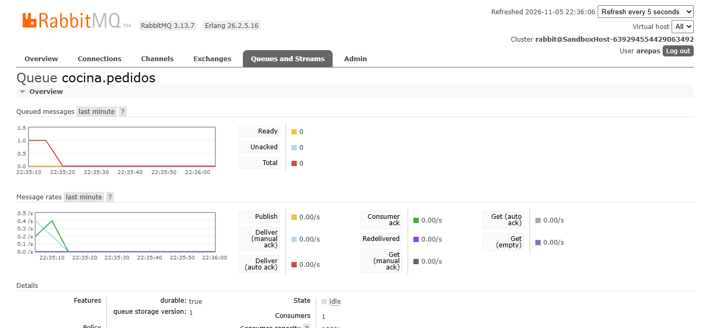

# Informe de Laboratorio: Arepa Express · API Gateway y RabbitMQ en Azure
**DOSW 1 · Semana 14**  
**Estudiante:** Oscar Lasso (`oscar.lasso-m@mail.escuelaing.edu.co` / `Oscar10lm`)  
**Alias del despliegue:** `oscarlasso`  

---

## 1. Arquitectura y Visión General

Arepa Express implementa una arquitectura de microservicios orientada a eventos en la nube de Azure:
- **API Gateway (Azure API Management - Plan Consumption):** Actúa como único punto de entrada público (`https://arepas-gw-oscarlasso.azure-api.net`), encargándose del enrutamiento de peticiones, validación de credenciales mediante llaves de suscripción (`Ocp-Apim-Subscription-Key`) y transformación de cabeceras de respuesta.
- **Microservicios síncronos (Azure Container Apps):**
  - `menu-service`: Expone el menú de arepas (`GET /menu`).
  - `pedidos-service`: Recibe pedidos (`POST /pedidos`) bajo arquitectura hexagonal, persiste/genera el identificador y emite asíncronamente el evento `PedidoCreadoEvent`.
- **Broker de Mensajería (RabbitMQ en Azure Container Instances):** Exchange de tipo `topic` llamado `arepas.eventos` que distribuye eventos sin acoplar temporal ni espacialmente a los servicios.
- **Consumidores asíncronos (Azure Container Apps):**
  - `cocina-service`: Cola `cocina.pedidos`, binding `pedido.*`.
  - `notificaciones-service`: Cola `notificaciones.pedidos`, binding `pedido.creado`.

---

## 2. Sección 1: API Gateway (Síncrono)

### 2.1. Acceso sin Llave (401 Unauthorized)
El API Gateway protege los servicios backend. Al invocar la ruta sin suministrar el encabezado `Ocp-Apim-Subscription-Key`, el gateway rechaza la petición directamente con código `401 Access Denied`, evitando consumo innecesario de cómputo en el microservicio.

- **Comando ejecutado:**
  ```bash
  curl -i https://arepas-gw-oscarlasso.azure-api.net/menu-api/menu
  ```
- **Evidencia requerida:**
  

---

### 2.2. Acceso con Llave y Política de Encabezado `X-Arepa-Gateway`
Al suministrar la llave maestra en la cabecera, la solicitud es validada y transferida al microservicio correspondiente. Mediante la política outbound configurada en el APIM, se inyecta automáticamente el encabezado de firma en la respuesta: `X-Arepa-Gateway: DOSW Company`.

- **Comando ejecutado:**
  ```bash
  curl -i https://arepas-gw-oscarlasso.azure-api.net/menu-api/menu \
    -H "Ocp-Apim-Subscription-Key: <PRIMARY_KEY>"
  ```
- **Respuesta obtenida:**
  ```http
  HTTP/1.1 200 OK
  Content-Type: application/json
  X-Arepa-Gateway: DOSW Company

  [{"id":1,"nombre":"Arepa de choclo con queso","precio":9000},{"id":2,"nombre":"Arepa rellena de pollo","precio":11000},{"id":3,"nombre":"Arepa de huevo","precio":7000}]
  ```
- **Evidencia requerida:**
  

---

## 3. Sección 2: Eventos con RabbitMQ (Asíncrono)

### 3.1. Panel de Administración de RabbitMQ
El broker corre sobre Azure Container Instances (`arepas-rabbit`) con el plugin de administración expuesto en el puerto `15672`.

- **URL de acceso:** `http://arepas-rabbit-oscarlasso.northcentralus.azurecontainer.io:15672`
- **Exchange:** `arepas.eventos` (tipo `topic`).
- **Colas activas:**
  - `cocina.pedidos` vinculada con routing key `pedido.*`.
  - `notificaciones.pedidos` vinculada con routing key `pedido.creado`.
- **Evidencia requerida:**
  
  

---

### 3.2. Creación del Pedido y Entrega de Uno a Muchos
Al enviar un pedido por el Gateway a `pedidos-service`:
```bash
curl -i -X POST https://arepas-gw-oscarlasso.azure-api.net/pedidos-api/pedidos \
  -H "Ocp-Apim-Subscription-Key: <PRIMARY_KEY>" \
  -H "Content-Type: application/json" \
  -d '{"cliente":"Oscar","arepas":["choclo","huevo"]}'
```
El cliente recibe de inmediato la respuesta `201 Created` (`{"pedidoId":"d6223171","estado":"RECIBIDO"}`), y RabbitMQ entrega de forma concurrente el mensaje tanto a `cocina-service` como a `notificaciones-service`.

- **Evidencia requerida:**
  
  

---

## 4. Experimentos

### Experimento 1: Uno a muchos (Publish / Subscribe)
- **Configuración:** Un único evento `pedido.creado` publicado en el Topic Exchange `arepas.eventos`.
- **Resultado:** El exchange enrutó copias independientes del mensaje a las dos colas vinculadas: `cocina.pedidos` (binding `pedido.*`) y `notificaciones.pedidos` (binding `pedido.creado`). Ambos microservicios procesaron el pedido simultáneamente.
- **Evidencia:** Respaldado por las capturas `03-rabbitmq-exchange-bindings.png`, `04-rabbitmq-queues.png` y `06-logs-consumidores.png`.
- **Conclusión técnica:** Si ambos servicios consumieran de una misma cola compartida, RabbitMQ balancearía los mensajes en modo round-robin (modelo *Competing Consumers*), provocando que un pedido solo fuera atendido por la cocina o por notificaciones, pero nunca por ambos.

### Experimento 2: Cola de trabajo (Escalado horizontal de consumidores)
- **Configuración:** Escalado del microservicio `cocina-service` a 2 réplicas (`--min-replicas 2 --max-replicas 2`) conectadas a la misma cola `cocina.pedidos`.
- **Resultado:** En el panel de RabbitMQ, la cola registra `Consumers: 2`. Al enviar una ráfaga de pedidos continuos, RabbitMQ distribuye los mensajes de manera alternada entre las dos réplicas disponibles.
- **Conclusión técnica:** Demuestra el patrón de *Work Queues*: a diferencia del modelo pub/sub entre colas distintas, múltiples consumidores escuchando una misma cola compiten por los mensajes para balancear la carga de procesamiento sin duplicar tareas.

### Experimento 3: Los mensajes esperan (Persistencia y desacoplamiento temporal)
- **Configuración:** Creación de una cola durable `auditoria.pedidos` vinculada a `arepas.eventos` con la routing key `pedido.#`, sin registrar ningún microservicio consumidor que la escuche.
- **Resultado:** Al emitir pedidos desde el gateway, el broker almacena los mensajes en la cola manteniéndolos en estado `Ready` y `Unacknowledged: 0`.
- **Conclusión técnica:** Demuestra la tolerancia a fallos y el desacoplamiento temporal de la arquitectura dirigida por eventos. Si un consumidor se desconecta o cae (por ejemplo, durante un despliegue o falla de red), los eventos no se pierden ni bloquean al emisor; permanecen persistidos en el broker hasta que el consumidor se restablezca.

---

## 5. Preguntas de Reflexión

### 1. ¿Qué pasa con los pedidos si `cocina-service` se cae por 5 minutos?
Los pedidos no se pierden. `pedidos-service` continúa recibiendo llamadas y publicando eventos con normalidad en el exchange `arepas.eventos`. RabbitMQ enruta los eventos hacia la cola durable `cocina.pedidos`, donde se acumulan con persistencia en memoria/disco. Cuando `cocina-service` se recupera y vuelve a conectarse, consume los mensajes represados secuencialmente a su propio ritmo.

### 2. ¿Por qué el gateway devuelve 401 sin que el servicio se entere?
Porque Azure API Management evalúa las directivas de seguridad en la etapa de pre-procesamiento (*inbound pipeline*), antes de abrir cualquier conexión hacia el backend. Al no detectar un encabezado válido de suscripción, el gateway interrumpe inmediatamente el ciclo de vida de la petición HTTP y retorna la respuesta de rechazo, protegiendo al servicio de tráfico no autenticado y optimizando el consumo de red y cómputo.

### 3. ¿Dónde validarías el token de un usuario: en el gateway o en cada microservicio?
En un esquema de producción se aplica un enfoque mixto, con validación primaria en el API Gateway:
- **En el Gateway:** Se valida la autenticidad, vigencia y firma del token JWT (o OAuth2) y se bloquea cualquier petición fraudulenta en el perímetro.
- **En los microservicios:** El gateway propaga los datos de identidad ya validados (claims, roles, tenant) hacia los servicios en cabeceras internas seguras para que cada servicio valide la autorización específica de dominio (RBAC/ABAC) según sus propias reglas de negocio.

### 4. ¿Qué pasa si el pedido se crea pero el evento no se alcanza a publicar?
Se generaría una inconsistencia de estado (*dual-write problem*): el cliente recibiría confirmación del pedido o este quedaría guardado, pero ni la cocina ni notificaciones se enterarían de su existencia. Para mitigar esto en arquitecturas distribuidas de misión crítica se aplican patrones como **Transactional Outbox**, donde la entidad y el evento se guardan en la misma transacción de base de datos antes de despacharse al broker.

### 5. ¿Cuándo usarías una cola y cuándo un tópico en Style Radar?
- **Cola (Punto a Punto / Competing Consumers):** Cuando una tarea debe ser procesada por **un único actor** especializado. Por ejemplo, la generación pesada de un render 3D o el procesamiento de una factura: si hay varios workers escuchando la cola, solo uno tomará la tarea para no duplicar trabajo.
- **Tópico (Publicación / Suscripción - Uno a Muchos):** Cuando un evento del negocio interesa a **múltiples dominios independientes**. Por ejemplo, el evento `PrendaPublicada`: al emitirse al tópico, el servicio de catálogo actualiza el feed, el servicio de búsqueda indexa la prenda y el servicio de recomendaciones recalcula afinidades, cada uno consumiendo desde su propia cola vinculada.

---

## 6. Enlaces a los Repositorios

- **Documentación y Entrega:** [https://github.com/arepa-express-dosw/docs](https://github.com/arepa-express-dosw/docs)
- **menu-service:** [https://github.com/arepa-express-dosw/menu-service](https://github.com/arepa-express-dosw/menu-service)
- **pedidos-service:** [https://github.com/arepa-express-dosw/pedidos-service](https://github.com/arepa-express-dosw/pedidos-service)
- **cocina-service:** [https://github.com/arepa-express-dosw/cocina-service](https://github.com/arepa-express-dosw/cocina-service)
- **notificaciones-service:** [https://github.com/arepa-express-dosw/notificaciones-service](https://github.com/arepa-express-dosw/notificaciones-service)

